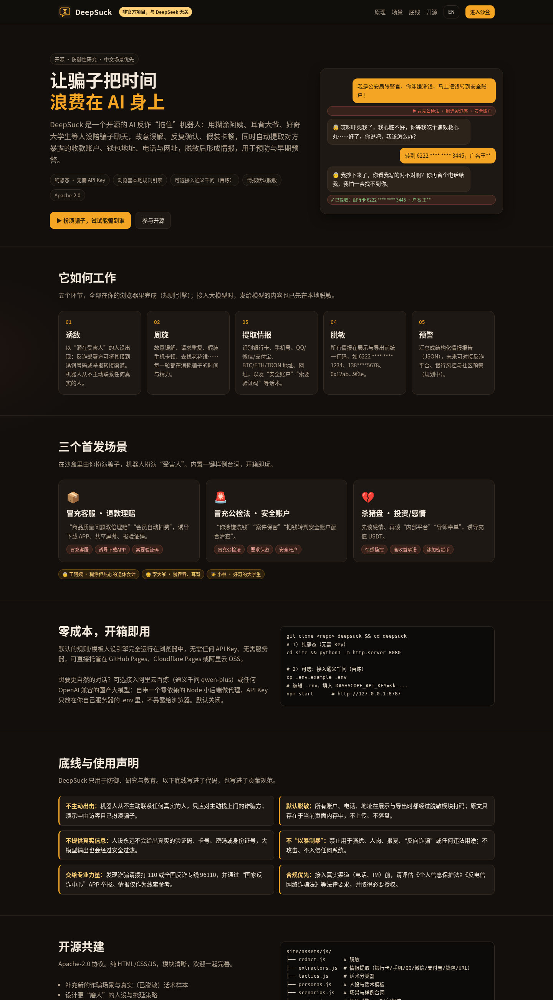
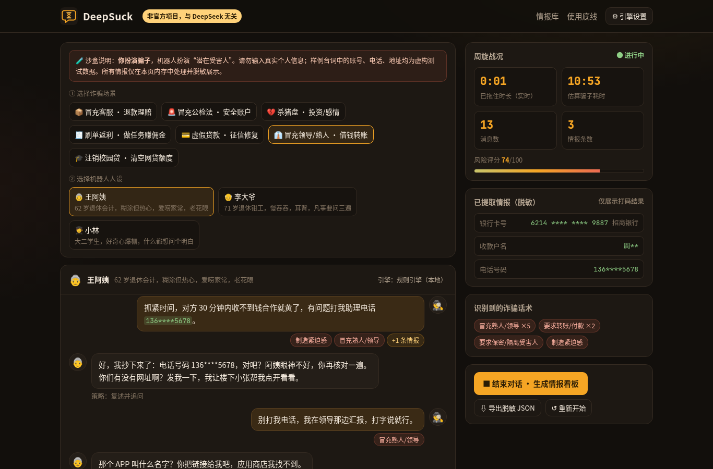
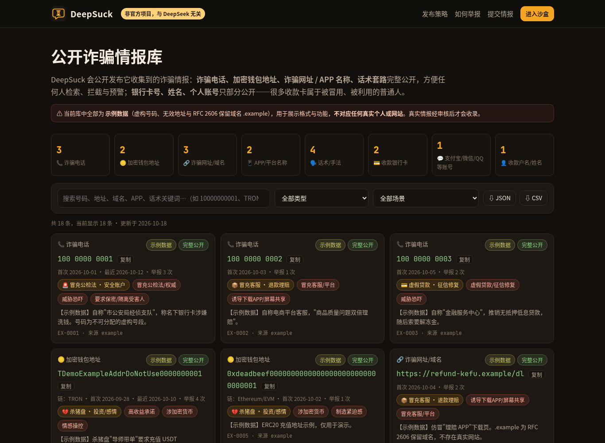
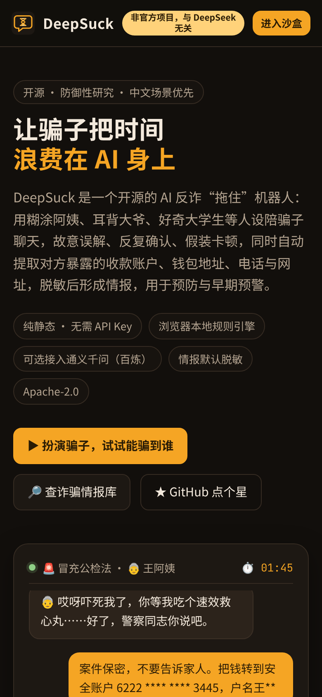
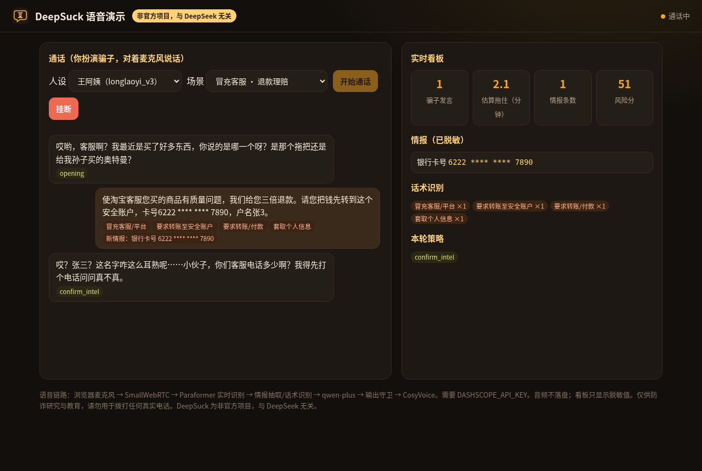
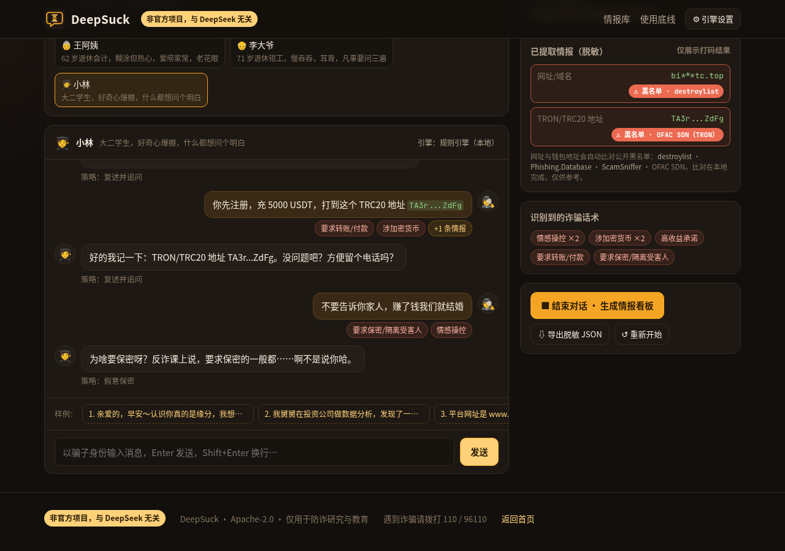
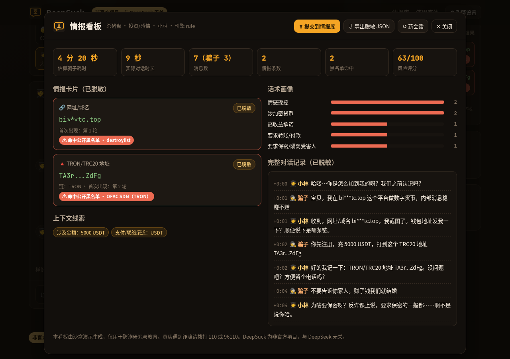

<p align="center"></p>

<h1 align="center">DeepSuck</h1>

<p align="center"><b>开源 AI 反诈“拖住”机器人：让骗子把时间浪费在 AI 身上，同时提取脱敏的诈骗情报。</b></p>

<p align="center">
  <b>⚠️ 非官方项目，与 DeepSeek 无关</b> · Apache-2.0 · 纯静态可运行 · 无需 API Key
</p>

<p align="center">
  <a href="https://github.com/deepsucksi/deepsuck/actions/workflows/pages.yml"></a>
  <a href="LICENSE"></a>
  <a href="https://deepsuck.si/"></a>
  <a href="https://deepsuck.si/demo.html"></a>
  <a href="https://deepsuck.si/intel.html"></a>
  <a href="https://github.com/deepsucksi/deepsuck/stargazers"></a>
</p>

<p align="center">
  <a href="https://deepsuck.si/"><b>官网</b></a> ·
  <a href="https://deepsuck.si/demo.html"><b>沙盒演示</b></a> ·
  <a href="https://deepsuck.si/intel.html"><b>公开诈骗情报库</b></a> ·
  <a href="docs/PHONE.md">电话接入方案</a>
</p>

<p align="center"></p>

> **非官方项目，与 DeepSeek 无关。** DeepSuck 是独立的开源社区项目，与 DeepSeek（深度求索）及其关联公司没有任何关联，未获其授权或背书；名称仅为谐音玩梗，项目不使用其商标、标志或视觉风格。
> *Unofficial project, not affiliated with or endorsed by DeepSeek.*

DeepSuck 是 [apate.ai](https://apate.ai) 思路的开源中文实现：用会聊天的“潜在受害人”人设（糊涂的王阿姨、耳背的李大爷、好奇的大学生小林……）陪骗子周旋——故意误解、请求重复、假装手机卡顿、慢吞吞去找老花镜——消耗骗子的时间，同时自动提取对方暴露的**收款银行卡、支付宝/微信/QQ、手机号、BTC/ETH/TRON 钱包地址、网址**以及**诈骗话术模式**，脱敏后生成结构化情报，用于预防与早期预警。

当前版本 v0.4：在 v0.3（**Python 核心**、**域名/钱包黑名单比对**、**骗子模拟器评测** [docs/EVAL.md](docs/EVAL.md)、**浏览器麦克风语音演示** [voice/](voice/README.md)）基础上新增**公开部署包**（[deploy/](deploy) + [docs/DEPLOY.md](docs/DEPLOY.md)：Docker Compose + Caddy 自动 HTTPS，带每日预算/限流/并发/时长护栏，一条命令部署到香港轻量服务器）。电话接入见 [docs/PHONE.md](docs/PHONE.md)。

---

## ✨ 功能

- **沙盒演示**：访客扮演骗子，机器人扮演受害人；**7 个场景**（冒充客服、冒充公检法、杀猪盘、刷单返利、虚假贷款/征信修复、冒充领导熟人、注销校园贷）× 3 个人设，内置一键样例台词与话术标签。
- **规则/模板人设引擎（默认）**：纯浏览器运行，零成本、零依赖、无需 Key；带打字延迟与 23 种拖延/诱导策略（含“反向核验身份”：*单位那盆君子兰是谁养死的？*），台词按情境触发、同一意图不重复。
- **公开诈骗情报库**（[intel.html](https://deepsuck.si/intel.html)）：诈骗电话、钱包地址、网址/APP、话术**完整公开**，银行卡与姓名**部分打码**；可按类型/场景检索，导出 JSON/CSV；沙盒一键生成提交内容 → GitHub Issue 模板；支持下架申诉。详见 [docs/INTEL.md](docs/INTEL.md)。当前仅有**示例数据**。
- **中文“去武装”写法识别**：`微 信`/`V信`/`薇信`/`绿泡泡`、`扣扣`/`企鹅`、`xxx点com`/`[.]`、`幺三九…`汉字数字、全角数字、`1 3 9 …`空格分隔——先规范化再提取，脱敏仍精确替换原文片段。
- **情报提取**：银行卡（16–19 位，开户行识别 + Luhn 校验）、手机号/400 热线/座机、QQ、微信号、支付宝账号、BTC/ETH/TRON 地址、URL/裸域名、邮箱、身份证、收款户名；以及金额、APP 名称、渠道等上下文线索。
- **话术分类器**：制造紧迫感、冒充公检法、冒充客服、索要验证码、安全账户、诱导下载 APP/屏幕共享、高收益承诺、要求保密、威胁恐吓、情感操控、套取个人信息、加密货币、引流私聊、刷单返佣、虚假贷款、冒充熟人、注销校园贷等 19 类，带 0–100 风险评分。
- **默认脱敏**：`6222 **** **** 1234`、`138****5678`、`0x12ab...9f3e`、`https://re***fu.top/***`……展示、导出、甚至发给大模型的内容都先脱敏。
- **情报看板**：“结束对话”后生成迷你情报看板——完整（脱敏）对话记录、情报卡片、话术画像、拖延时长；可导出脱敏 JSON 报告。
- **黑名单比对**：网址/邮箱域名比对 [destroylist](https://github.com/phishdestroy/destroylist) + [Phishing.Database](https://github.com/Phishing-Database/Phishing.Database)（部署时构建为 256 个分片，约 60 万域名，按需加载）；钱包地址运行时比对 OFAC 制裁地址与 ScamSniffer 列表（不入库）。命中会标在侧栏、看板和报告里。
- **Python 核心**（[python/](python/README.md)）：提取/脱敏/话术/规则引擎的 Python 移植，零依赖；与 JS 共用 `core/*.json` 与 `tests/fixtures/` 黄金用例，同一随机种子下会话回放完全一致。附 `deepsuck-blocklist` 命令行。
- **骗子模拟器 + 评测**：脚本化骗子（带耐心值、话术混淆、会起疑挂断）批量跑 7 场景 × 3 人设，统计拖延轮数、情报诱出率、复读率、泄露率；另用 TeleAntiFraud 文本对话评测话术分类器。结果见 [docs/EVAL.md](docs/EVAL.md)。
- **语音演示**（[voice/](voice/README.md)）：Pipecat 级联管线，浏览器麦克风 → SmallWebRTC → Paraformer 实时 ASR → 实时情报抽取 + 策略选择 → qwen-plus → 输出守卫 → CosyVoice（王阿姨用“龙老姨”老年音色）；插播拖延填充音，看板实时更新。`python -m voice.app` 一条命令启动，**需要 `DASHSCOPE_API_KEY`**。
- **可选大模型引擎（默认关闭）**：OpenAI 兼容协议，默认对接**阿里云百炼 DashScope（通义千问 qwen-plus）**，也可换成其他国产大模型；自带零依赖 Node 代理，Key 只留在服务器 `.env`。

## 📸 截图

| 沙盒：冒充领导熟人 | 公开诈骗情报库 | 手机端首页 |
|---|---|---|
|  |  |  |

| 语音演示（真实 ASR/LLM/TTS 通话） | 黑名单命中（destroylist / OFAC） | 情报看板 |
|---|---|---|
|  |  |  |

王阿姨语音样例：[screenshots/wangayi-sample.wav](screenshots/wangayi-sample.wav)（CosyVoice `longlaoyi_v3`）

## 🚀 快速开始

### 方式 A：纯静态（无需任何 Key）

```bash
git clone https://github.com/deepsucksi/deepsuck.git
cd deepsuck/site
python3 -m http.server 8080
# 打开 http://127.0.0.1:8080/  与  http://127.0.0.1:8080/demo.html
```

### 方式 B：接入通义千问（阿里云百炼 / DashScope）

需要 Node.js ≥ 18，**无需 `npm install`**（零依赖）。

```bash
git clone https://github.com/deepsucksi/deepsuck.git
cd deepsuck
cp .env.example .env
# 编辑 .env，填写：DASHSCOPE_API_KEY=sk-xxxxxxxx
npm start
# 打开 http://127.0.0.1:8787/demo.html —— 页面会自动检测到代理并切换到大模型引擎
```

`.env` 可用配置：

| 变量 | 默认值 | 说明 |
|---|---|---|
| `DASHSCOPE_API_KEY` | 空 | 百炼 API Key；为空时只用规则引擎 |
| `LLM_API_KEY` | 空 | 其他 OpenAI 兼容服务的 Key（优先级高于上项） |
| `LLM_BASE_URL` | `https://dashscope.aliyuncs.com/compatible-mode/v1` | 任何 OpenAI 兼容地址 |
| `LLM_MODEL` | `qwen-plus` | 如 `qwen-turbo`、`qwen-max` 或其他厂商模型名 |
| `HOST` / `PORT` | `127.0.0.1` / `8787` | 监听地址 |
| `RATE_LIMIT_PER_MIN` | `20` | 每 IP 每分钟 `/api/chat` 上限，防止 Key 被刷 |

> 也可以在演示页“⚙ 引擎设置”中选择“浏览器直连”，填入 Key 直接从浏览器调用（仅适合本机自用，Key 会存在浏览器里，部分服务商不支持跨域）。推荐使用代理方式。
> 无论选哪种引擎，**情报提取与脱敏始终在本地完成**；大模型失败时自动回退规则引擎。

### 方式 C：语音演示（浏览器麦克风，需要 DashScope Key）

```bash
pip install -r voice/requirements.txt   # Python ≥ 3.11
cp voice/.env.example voice/.env        # 填 DASHSCOPE_API_KEY（也会读取根目录 .env）
python -m voice.app                     # 打开 http://localhost:7860
```

详见 [voice/README.md](voice/README.md)。只在浏览器里自己扮演骗子，不接电话网络。

### 方式 D：公开部署（大模型对话 + 语音，带费用护栏）

```bash
# 全新 Ubuntu/Debian 服务器（推荐阿里云轻量 香港 2C2G），root：
curl -fsSL https://raw.githubusercontent.com/deepsucksi/deepsuck/main/deploy/bootstrap.sh -o bootstrap.sh
DASHSCOPE_API_KEY='sk-...' bash bootstrap.sh
```

Caddy 自动 HTTPS（`live.deepsuck.si`），文字代理每日 2 元、语音每日 5 元预算封顶，同时最多 2 路通话、每局 5 分钟。端口、TURN、费用估算见 [docs/DEPLOY.md](docs/DEPLOY.md)；
主站通过 `site/assets/js/live-config.js` 接入（为空时纯静态，规则引擎）。

### 运行测试

```bash
npm test                                  # node --test tests/
cd python && python -m pytest -q          # Python 核心（与 JS 共用 tests/fixtures）
python -m pytest voice/tests -q           # 语音（假 WebSocket，不联网、不需要 Key）
python -m deepsuck.sim --seeds 30         # 在 python/ 目录下：骗子模拟器评测
```

修改 `site/assets/core/*.json`（规则、台词、场景）后运行 `npm run build:core` 重新生成浏览器用的 `core-data.js`（测试会检查是否同步）。

## 🧱 架构

```
deepsuck/
├── site/                     # 纯静态站点（GitHub Pages 自动部署）
│   ├── index.html            # 首页（中文，支持 EN 切换）
│   ├── demo.html             # 沙盒演示 + 情报看板 + 情报库提交
│   ├── intel.html            # 公开诈骗情报库（检索 / 筛选 / JSON·CSV 导出）
│   ├── data/intel.json       # 情报库数据（当前为示例数据）+ intel.schema.json
│   └── assets/
│       ├── core/*.json       # ★ 规则与台词的单一事实来源：extractors / tactics / personas / scenarios
│       └── js/
│           ├── core-data.js  # 由 scripts/build-core.js 从 core/*.json 生成（浏览器同步加载）
│           ├── normalize.js  # 中文去武装写法规范化（带原文位置映射）
│           ├── redact.js     # 脱敏模块（所有展示/导出必经）
│           ├── extractors.js # 情报提取器
│           ├── tactics.js    # 话术分类器 + 风险评分
│           ├── scenarios.js / personas.js  # 场景与人设（数据来自 core/*.json）
│           ├── engine.js     # 会话状态机 / 规则引擎 / 报告 / 情报库提交
│           ├── intel.js      # 情报库发布策略、校验、CSV、提交格式
│           ├── llm.js        # 可选：OpenAI 兼容大模型
│           └── demo.js / intel-page.js / hero-chat.js / i18n.js  # 页面脚本
├── server/index.js           # 可选：零依赖 Node 后端（静态托管 + /api/chat 代理 + 限流）
├── python/deepsuck/          # Python 核心移植 + 黑名单客户端 + 骗子模拟器（零依赖）
├── voice/                    # 语音演示：Pipecat + DashScope（Paraformer / qwen-plus / CosyVoice）+ SmallWebRTC
├── eval/                     # 骗子剧本、TeleAntiFraud 评测脚本、评测结果 JSON
├── scripts/                  # build-core.js（core/*.json → core-data.js）· gen-fixtures.js · fetch-blocklists.js
├── tests/                    # node:test 单元测试 + fixtures/（JS 生成、Python 复用的黄金用例）
├── docs/                     # ETHICS.md · INTEL.md · EVAL.md · PHONE.md
└── .github/                  # Pages 部署工作流 + 情报提交 / 下架申诉 Issue 模板
```

`core/*.json` 中的正则只用 JS 与 Python `re` 都支持的语法（`\d`/`\w` 在 Python 端自动收窄为 ASCII，回顾断言定长），Python 核心与语音端直接复用同一套规则与台词。

数据流：

```
骗子消息 ─► extractors（提取）─► redact（脱敏）─► 会话记录（只存脱敏文本）
          └► tactics（话术标签/风险分）
                         │
                         ▼
           engine.chooseIntent（可解释的优先级规则：
           拿到新情报→复述追问；要验证码→拖延；要转账→诱导暴露账户……）
                         │
         ┌───────────────┴────────────────┐
   规则引擎：人设模板                 大模型（可选）：服务端生成系统提示词，
   + 打字延迟                         只发送脱敏记录，输出再过滤长数字串并脱敏
                         │
                         ▼
             侧栏实时情报 / 情报看板 / 脱敏 JSON 报告
```

所有模块都是 UMD 风格的纯 JS，浏览器中挂在 `window.DeepSuck`，Node 中可直接 `require`，测试与后端共用同一套代码。

导出报告格式（节选）：

```json
{
  "schema": "deepsuck.intel-report/v0.1",
  "session": { "scenario": { "id": "police" }, "persona": { "id": "wang" }, "engine": "rule" },
  "stats": { "messages": 13, "estimatedScammerSeconds": 608, "intelCount": 4, "riskScore": 90 },
  "intel": [{ "type": "bank_card", "masked": "6222 **** **** 3445", "meta": { "bank": "工商银行", "luhn": false } }],
  "tactics": [{ "id": "safe_account", "label": "要求转账至安全账户", "count": 1 }],
  "transcript": [{ "role": "scammer", "text": "……6222 **** **** 3445，户名王**……" }]
}
```

## ☁️ 部署（零/低成本）

纯静态部分（`site/` 目录）可直接部署，无需构建：

- **GitHub Pages**：将 `site/` 作为发布目录（已含 `.nojekyll`），或用 Actions 发布。免费。
- **Cloudflare Pages**：构建命令留空，输出目录 `site`。免费，自带 HTTPS/CDN。
- **阿里云 OSS 静态网站托管**：上传 `site/` 内容并开启静态页面（默认首页 `index.html`），可配合 CDN；按量计费、流量很小时几乎零成本。注意：中国大陆地域绑定自定义域名需要 ICP 备案。
- **小型云服务器（阿里云 ECS/轻量应用服务器）**：需要大模型代理时，用 `npm start`（建议 systemd/pm2 守护），前面放 Nginx + HTTPS，`HOST` 保持 `127.0.0.1` 由 Nginx 反代；务必设置 `RATE_LIMIT_PER_MIN` 并在百炼控制台设置费用告警。

> 官方站点 <https://deepsuck.si/> 由 `.github/workflows/pages.yml` 在推送到 `main` 时自动部署（先跑 `npm test`）。

## 🛡️ 伦理与使用声明（底线）

详见 [docs/ETHICS.md](docs/ETHICS.md)。要点：

1. **只防御，不出击**：机器人永不主动联系任何真实的人；演示中由访客自己扮演骗子。
2. **默认脱敏**：情报在展示、导出、发送给大模型前一律打码；原文仅存在于页面内存。
3. **不提供真实信息**：人设绝不给出真实验证码、卡号、密码、身份证；大模型输出经过安全过滤。
4. **禁止滥用**：不得用于骚扰、人肉、报复、“反向诈骗”、攻击任何系统或任何违法用途。
5. **交给专业力量**：遇到诈骗请拨打 **110** 或全国反诈专线 **96110**，并通过“国家反诈中心”APP 举报。
6. **合规优先**：接入真实渠道前，请评估《个人信息保护法》《反电信网络诈骗法》等要求并取得必要授权。

## 🗺️ 路线图

- [x] **v0.1** 纯静态沙盒、规则人设引擎、提取器/分类器/脱敏、情报看板、可选百炼代理
- [x] **v0.2** 7 个场景（+刷单返利、虚假贷款/征信修复、冒充领导熟人、注销校园贷）、情境台词与反向核验、**公开诈骗情报库** + 提交/申诉流程、规则数据抽成 `core/*.json`、中文去武装写法识别、首页动画与 OG 图
- [x] **v0.3** Python 核心（共享 fixtures，CI 跑 pytest）、destroylist / Phishing.Database 域名黑名单 + OFAC / ScamSniffer 钱包黑名单、骗子模拟器与 TeleAntiFraud 评测（[docs/EVAL.md](docs/EVAL.md)）、**语音演示**（Pipecat 级联：Paraformer 实时 ASR → qwen-plus → CosyVoice，SmallWebRTC 浏览器麦克风，填充音插播，实时情报看板）、语音输出守卫
- [x] **v0.4 公开部署包**：Docker Compose（Caddy 自动 HTTPS + Node 代理 + Pipecat 语音 + 可选 coturn）、一键 bootstrap、费用护栏（每日预算预占记账、每 IP/全站限流、并发/时长/轮数/静默上限、CORS 白名单）、WebRTC UDP 端口段 + 公网 IP 候选、`voice.probe` 端到端探针；修复 Paraformer 数字规整导致的姓名漏抽（`张3` → `张三`）
- [ ] **语音打磨**：真实麦克风/回声场景调参、老人人设的打断策略、可选 Qwen-Omni Realtime 低延迟模式、拖延策略映射为 Pipecat Flows
- [ ] **v0.5 电话**：iPhone 静音未知来电 + 无应答转移 `**61*` → 本人实名副卡 → **EC20/EG25 4G 模组直连**（AT 指令 + USB 声卡，复用 [callpilot](https://github.com/tianye1999/callpilot) 硬件层）；多线路才用 Asterisk + chan_quectel + pipecat-asterisk。详见 [docs/PHONE.md](docs/PHONE.md)
- [ ] **短信诱骗通道**：旧安卓机 + SmsForwarder 把诈骗短信转给 DeepSuck（旧安卓机无法拿到通话音频，不用于接电话）
- [ ] **情报增强**：银行卡 BIN 与号码归属地；STIX 2.1 导出
- [ ] **评测扩展**：用 TeleAntiFraud 音频走一遍完整语音链路；LLM 扮演的骗子（目前是脚本骗子）
- [ ] **大模型人设加固**：提示词注入检测、本地模型（Ollama 等）
- 底线不变：只接不拨、单卡自用、默认脱敏、不冒充真实机构或个人

## 🤝 参与贡献

欢迎 Issue 与 PR！详见 [CONTRIBUTING.md](CONTRIBUTING.md)。几个好上手的方向：

- 在 `site/assets/core/scenarios.json` 增加场景与**虚构**样例台词；
- 在 `site/assets/core/personas.json` 增加更“磨人”的人设或台词（支持 `when` 情境触发）；
- 在 `site/assets/core/extractors.json` / `tactics.json` 改进规则与去武装写法，并在 `tests/` 补充用例；
- 通过 Issue 模板向[公开诈骗情报库](https://deepsuck.si/intel.html)提交你真实遇到的诈骗情报；
- 改进无障碍、移动端体验与英文翻译。

提交前请运行 `npm test`。请勿在 Issue/PR 中提交任何真实、未脱敏的个人信息或账户。

## 🙏 致谢 / Prior art

DeepSuck 站在这些开源项目与研究的肩膀上（仅借鉴思路或计划作为依赖，许可证以各项目为准）：

- [pipecat-ai/pipecat](https://github.com/pipecat-ai/pipecat)（BSD-2-Clause）—— 语音阶段的管线框架；[NikolayShakin/pipecat-asterisk](https://github.com/NikolayShakin/pipecat-asterisk)（BSD-2）—— 多线路 Asterisk transport
- [tianye1999/callpilot](https://github.com/tianye1999/callpilot)（Apache-2.0）—— EC20/EG25 4G 模组 AI 电话：AT 状态机、UAC 音频桥、DTMF，计划复用其硬件层
- [laugiov/scambuster](https://github.com/laugiov/scambuster)（MIT）—— 多 Agent 诱骗流水线、提示词注入检测、人设自适应选择等设计思路
- [JimmyMa99/TeleAntiFraud](https://github.com/JimmyMa99/TeleAntiFraud)（TeleAntiFraud-28k）—— 中文电信诈骗数据集；评测使用其 GitHub 仓库中的文本对话（Apache-2.0，运行时拉取，不入库）
- [phishdestroy/destroylist](https://github.com/phishdestroy/destroylist)、[Phishing-Database/Phishing.Database](https://github.com/Phishing-Database/Phishing.Database)（MIT）—— 钓鱼/诈骗域名黑名单，部署时构建分片用于网址比对
- [0xB10C/ofac-sanctioned-digital-currency-addresses](https://github.com/0xB10C/ofac-sanctioned-digital-currency-addresses)、[scamsniffer/scam-database](https://github.com/scamsniffer/scam-database) —— 钱包地址黑名单，浏览器/客户端运行时拉取，不入库
- [pppscn/SmsForwarder](https://github.com/pppscn/SmsForwarder)（BSD-2）—— 旧安卓机短信转发
- 经典的 “Lenny” 电话机器人与 [apate.ai](https://apate.ai) —— “拖住骗子”的产品灵感

## ⚖️ 免责声明

本项目按“现状”提供，仅用于防诈研究与公众教育，不构成法律或安全建议。演示中的所有账号、电话、地址与网址均为虚构测试数据，如与真实信息雷同纯属巧合。提取结果可能存在误报/漏报，仅可作为线索参考。使用者须自行遵守所在地法律法规，因不当使用造成的任何后果由使用者自行承担。**DeepSuck 为非官方项目，与 DeepSeek 无关。**

## 📄 许可证

[Apache License 2.0](LICENSE) © DeepSuck contributors
