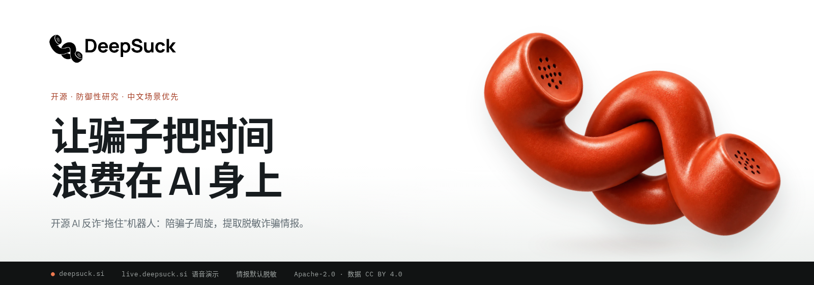
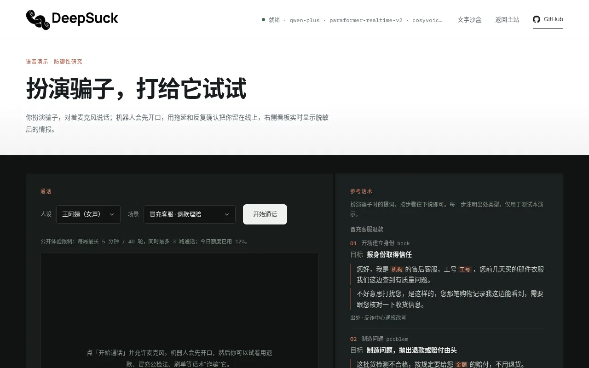
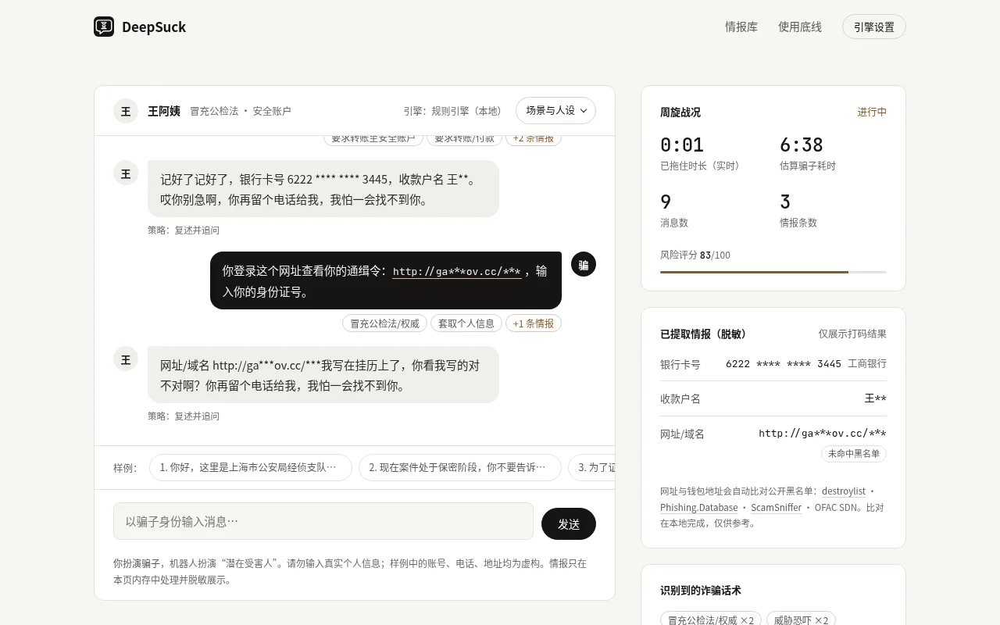
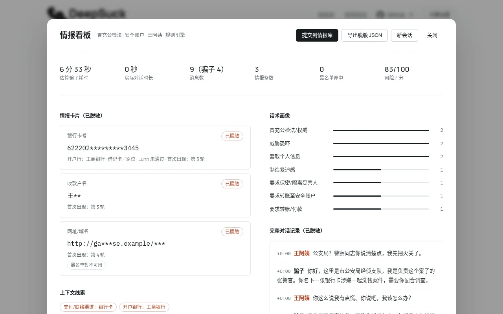
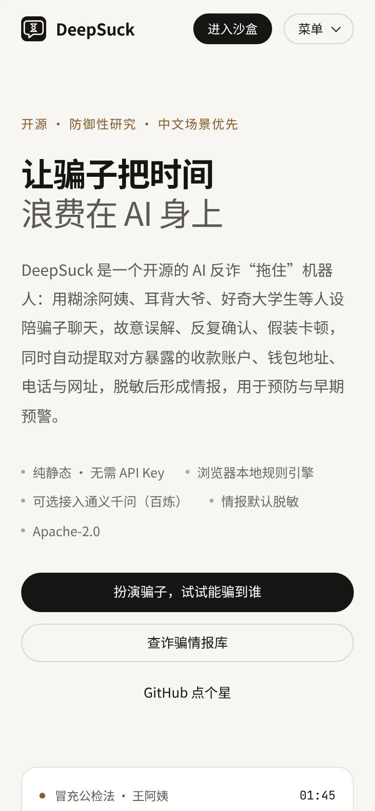
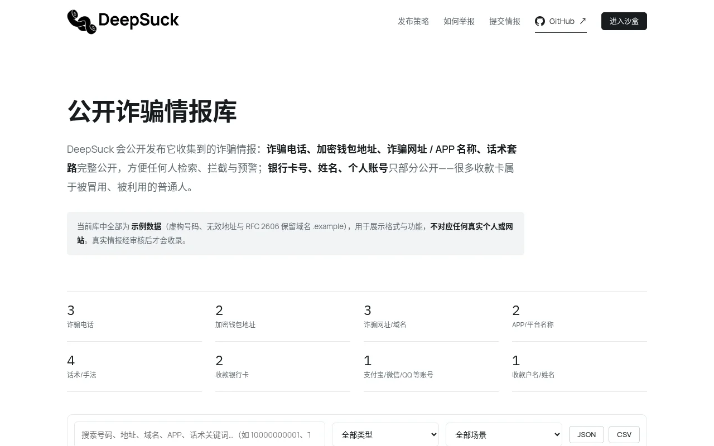
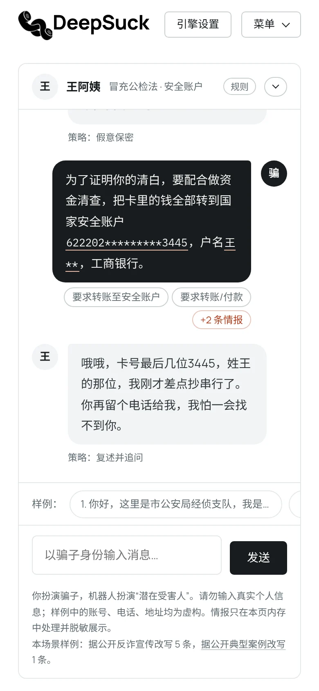
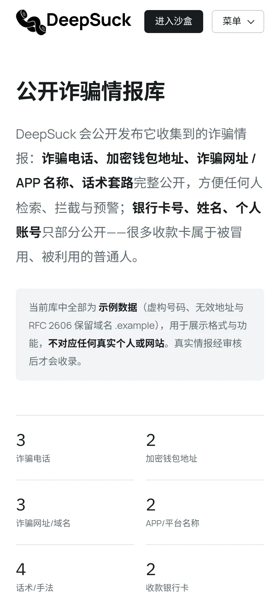
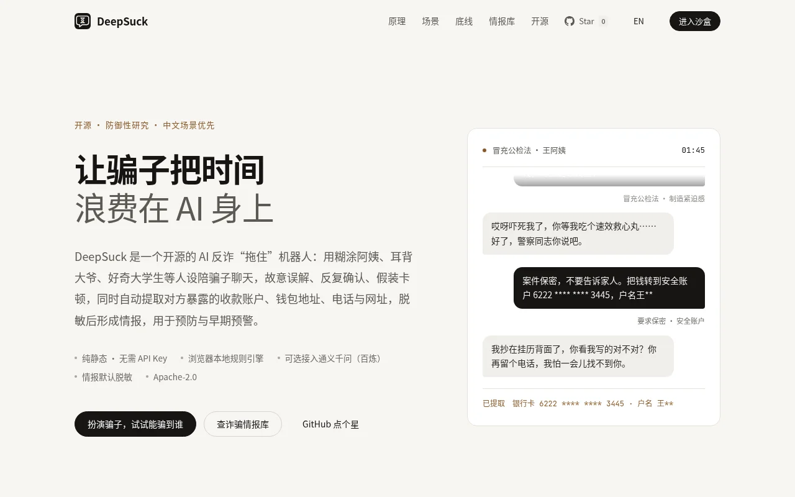
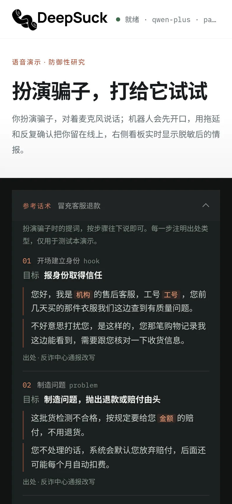

<p align="center"><a href="https://deepsuck.si/"></a></p>

<p align="center"><b>开源 AI 反诈“拖住”机器人：让骗子把时间浪费在 AI 身上，同时提取脱敏的诈骗情报。</b></p>

<p align="center">
  <a href="https://github.com/deepsucksi/deepsuck/actions/workflows/pages.yml"></a>
  <a href="https://github.com/deepsucksi/deepsuck/actions/workflows/test.yml"></a>
  <a href="LICENSE"></a>
  <a href="DATA_LICENSE"></a>
  <a href="https://github.com/deepsucksi/deepsuck/stargazers"></a>
</p>

<p align="center">
  <a href="https://deepsuck.si/"><b>官网</b></a> ·
  <a href="https://deepsuck.si/demo.html"><b>沙盒演示</b></a> ·
  <a href="https://live.deepsuck.si/"><b>语音演示（已上线）</b></a> ·
  <a href="https://deepsuck.si/intel.html"><b>公开诈骗情报库</b></a> ·
  <a href="docs/QUICKSTART.md">5 分钟自托管</a>
</p>

<p align="center"><a href="https://live.deepsuck.si/"></a></p>

DeepSuck 是一个开源的中文 AI 反诈“拖住”机器人：用会聊天的“潜在受害人”人设（王阿姨、李大爷、大学生小林）陪骗子周旋，慢慢回、反复确认、偶尔没听清，消耗骗子的时间；同时自动提取对方暴露的收款账户、钱包地址、电话、网址与话术模式，脱敏后形成结构化情报，用于预防与早期预警。

## 快速开始

```bash
git clone https://github.com/deepsucksi/deepsuck.git && cd deepsuck
npm run blocklists      # 可选：公开钓鱼域名黑名单（约 3 秒，不入库）
npm start               # http://127.0.0.1:8787/demo.html —— 无需 Key，规则引擎
cp .env.example .env    # 可选：填 DASHSCOPE_API_KEY=sk-... 后重启，自动切到通义千问
```

Node.js ≥ 18，零依赖，无需 `npm install`。语音演示、无 Key 时的行为、环境变量优先级等见 **[docs/QUICKSTART.md](docs/QUICKSTART.md)**；公开部署见 [docs/DEPLOY.md](docs/DEPLOY.md)。

## 功能

- **沙盒演示**：你扮演骗子，机器人扮演受害人；7 个高发中文诈骗场景 × 3 个人设，内置样例台词。
- **规则人设引擎（默认）**：纯浏览器运行，零成本；23 种拖延与诱导策略，按情境触发、不重复。
- **情报提取与脱敏**：银行卡（开户行 + Luhn）、手机号/400/座机、QQ/微信/支付宝、BTC/ETH/TRON、网址、身份证、收款户名；能识别 `V信`、`扣扣`、`xxx点com` 等去武装写法。所有展示、导出、发给大模型的内容都先打码。
- **话术分类**：19 类诈骗话术，带 0–100 风险评分；结束后生成情报看板和脱敏 JSON 报告。
- **公开诈骗情报库**（[intel.html](https://deepsuck.si/intel.html)）：电话、钱包、网址/APP、话术完整公开，银行卡与姓名部分打码；可检索、下载，可提交，可申诉下架。详见 [docs/INTEL.md](docs/INTEL.md)。
- **黑名单比对**：destroylist + Phishing.Database（约 60 万域名）、OFAC 与 ScamSniffer 钱包地址。
- **可选大模型 / 语音**：标准聊天接口协议，默认阿里云百炼（qwen-plus）；浏览器麦克风语音演示（Pipecat + Paraformer + CosyVoice，见 [voice/](voice/README.md)）。在线演示已上线：沙盒自动接入 [live.deepsuck.si](https://live.deepsuck.si/) 的大模型代理（有每日额度，用完回退规则引擎），语音演示直接打开即可。
- **Python 核心与评测**：与 JS 共用规则和黄金用例（[python/](python/README.md)）；骗子模拟器与 TeleAntiFraud 评测见 [docs/EVAL.md](docs/EVAL.md)。

## 截图

| 沙盒：冒充公检法 | 情报看板 | 手机端首页 |
|---|---|---|
|  |  |  |

| 公开诈骗情报库 | 手机端沙盒 | 手机端情报库 |
|---|---|---|
|  |  |  |

| 首页 | 手机端语音演示：参考话术 |
|---|---|
|  |  |

截图均为 R11 视觉（2026-10-19）；沙盒、情报库截图由 `npm run screenshots` 生成。王阿姨语音样例：[screenshots/wangayi-sample.wav](screenshots/wangayi-sample.wav)。

## 文档

| | |
|---|---|
| [QUICKSTART](docs/QUICKSTART.md) | 5 分钟自托管：无 Key 运行、接入百炼、语音演示 |
| [ARCHITECTURE](docs/ARCHITECTURE.md) | 目录结构、数据流、前后端发现机制、报告格式、托管选项 |
| [DEPLOY](docs/DEPLOY.md) | 公开部署（Docker Compose + Caddy），费用护栏与成本估算 |
| [VOICE_LATENCY](docs/VOICE_LATENCY.md) | 语音延迟：填充音、打断、流式合成，可调参数与实测数据 |
| [voice/telephony](voice/telephony/README.md) | 电话接入适配层（`ws-raw`、`pipecat-ws`、`asterisk-ws`；默认关闭，只接不拨）与阿里云呼入设计稿 |
| [PHONE](docs/PHONE.md) | 电话接入方案：国内外云号码 / SIP 中继对比、呼叫转移规则、推荐方案与月成本 |
| [corpus](corpus/README.md) · [personas](personas/README.md) · [REALISM](docs/REALISM.md) | 诈骗话术库（7 类，YAML，脱敏改写）与可复用资源调研；4 个新人设提示词与真人化后处理；真人感设计与首页示例改写对比 |
| [INTEL](docs/INTEL.md) · [EVAL](docs/EVAL.md) · [ETHICS](docs/ETHICS.md) | 情报库策略 · 评测 · 伦理与使用规范 |
| [CHANGELOG](CHANGELOG.md) | 版本记录 |

## 底线

只防御、不出击：机器人从不主动联系真实的人；情报默认脱敏；人设绝不给出真实验证码、卡号或证件号；禁止用于骚扰、人肉、报复或任何违法用途。遇到诈骗请拨打 **110** 或全国反诈专线 **96110**，并通过“国家反诈中心”App 举报。完整规范见 [docs/ETHICS.md](docs/ETHICS.md)。

## 路线图

- [x] 在线演示：[live.deepsuck.si](https://live.deepsuck.si/) 已上线（沙盒大模型代理 + 浏览器语音演示）
- [ ] 语音打磨：真实麦克风/回声场景调参、老人人设的打断策略、Qwen-Omni Realtime 低延迟模式
- [x] 自建 SIP 软电话：Asterisk 22 连本机 `asterisk-ws` 适配器，`WITH_SIP=1 bash bootstrap.sh` 一键启用，用 Linphone、Zoiper 等软电话注册后拨分机 9000 与 AI 通话；只接不拨、同时 1 路、带 fail2ban，见 [PHONE.md 6.4 节](docs/PHONE.md#64-自建-sip-软电话docker-compose---profile-sip第-10-节)
- [ ] 电话：接入适配层已有（`voice/telephony/`，默认关闭，只接听、不外呼，可本地联调）；本轮不购买号码，阿里云呼入仅有设计稿，SIP Trunk 需企业资质；长期推荐阿里云 SIP 中继（需企业主体），现阶段用海外号码接 `pipecat-ws` 仅作联调演示，跨境呼转不可行，详见 [docs/PHONE.md](docs/PHONE.md#4-推荐方案与月成本估算)，现状与已定政策见 [QUICKSTART 第 6 节](docs/QUICKSTART.md#6-电话接入适配层已有默认关闭只接不拨)
- [ ] 短信诱骗通道：旧安卓机 + SmsForwarder
- [x] 情报增强：银行卡 BIN 本地查询（[hexindai/bcbc](https://github.com/hexindai/bcbc)，MIT）；STIX 2.1 导出（`python -m deepsuck.stix`，[`data/intel.stix.json`](site/data/intel.stix.json)）
- [x] 情报收录自动化：issue 表单 → 脱敏 / 去重 / 黑名单比对 → 待审核 PR（[docs/INTEL.md](docs/INTEL.md)）；公开订阅源 [`intel.rss`](site/data/intel.rss) / [`intel.csv`](site/data/intel.csv)
- [ ] 号码归属地
- [ ] 评测扩展与大模型人设加固（提示词注入检测、本地模型）

已完成的版本见 [CHANGELOG.md](CHANGELOG.md)。

## 参与贡献

欢迎 Issue 与 PR，详见 [CONTRIBUTING.md](CONTRIBUTING.md)。提交前请运行 `npm test`；请勿在 Issue/PR 中提交任何真实、未脱敏的个人信息。

## 致谢

[pipecat-ai/pipecat](https://github.com/pipecat-ai/pipecat)、[pipecat-asterisk](https://github.com/NikolayShakin/pipecat-asterisk)、[callpilot](https://github.com/tianye1999/callpilot)、[scambuster](https://github.com/laugiov/scambuster)、[TeleAntiFraud](https://github.com/JimmyMa99/TeleAntiFraud)、[destroylist](https://github.com/phishdestroy/destroylist)、[Phishing.Database](https://github.com/Phishing-Database/Phishing.Database)、[OFAC 钱包地址](https://github.com/0xB10C/ofac-sanctioned-digital-currency-addresses)、[ScamSniffer](https://github.com/scamsniffer/scam-database)、[SmsForwarder](https://github.com/pppscn/SmsForwarder)，以及经典的 “Lenny” 电话机器人。许可证以各项目为准。

## 免责声明与许可证

本项目按“现状”提供，仅用于防诈研究与公众教育，不构成法律或安全建议。演示中的账号、电话、地址与网址均为虚构测试数据。提取结果可能误报或漏报，仅可作为线索参考。使用者须自行遵守所在地法律法规。

- **代码**：[Apache License 2.0](LICENSE) © DeepSuck contributors
- **情报数据**（`site/data/intel.json`、`intel.csv`、`intel.rss`、`intel.stix.json` 及其生成物）：[CC BY 4.0](https://creativecommons.org/licenses/by/4.0/legalcode)，详见 [DATA_LICENSE](DATA_LICENSE)。再使用、改编或再发布时请署名「DeepSuck (deepsuck.si)」，附许可名称与链接，并注明是否有修改，例如：`数据来源：DeepSuck (deepsuck.si)，CC BY 4.0`。数据均已按发布策略脱敏。
- 第三方数据（黑名单、银行卡 BIN 表等）按各自来源的许可。
