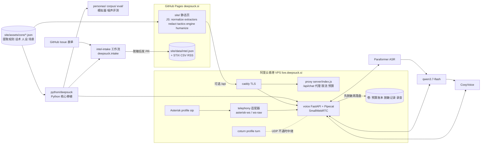

# 架构（docs/ARCHITECTURE.md）

> 本页先给模块级的全景、边界与已知风险，后半部分是文件级目录与细节。关键决策见 [adr/](adr/)，开发流程见 [CONTRIBUTING-dev.md](CONTRIBUTING-dev.md)。

## 全景

三个运行面，共用一份规则数据：

- **静态站点**（GitHub Pages，deepsuck.si）：`site/`，浏览器内跑规则引擎，没有服务器也能用。
- **实时服务**（阿里云香港单台 VPS，live.deepsuck.si）：`deploy/docker-compose.yml` 起 caddy（TLS）、proxy（`server/`，大模型代理与费用护栏）、voice（`voice/`，语音演示），可选 coturn（profile `turn`）与 Asterisk（profile `sip`）。
- **离线与自动化**：`python/deepsuck`（Python 核心）、`personas/` `corpus/` `eval/`（人设、语料、评测）、情报提交 IssueOps（`.github/workflows/intel-intake.yml` → `deepsuck.intake`）。



语音一轮的数据流：麦克风 → WebRTC（或电话适配器）→ Paraformer 识别 → `deepsuck` 提取并脱敏 → `voice/persona.py` 组系统提示词 → qwen3.7-flash → 输出守卫（不给真实号码、号码逐位读）→ CosyVoice → 回传。网页与电话共用 `voice/app.py` 的 `build_pipeline`。

## 模块边界

| 模块 | 职责 | 可以依赖 | 不应依赖 |
|---|---|---|---|
| `site/assets/core/*.json` | 规则与台词的单一事实来源（ADR 0001） | 无 | 任何代码 |
| `site/assets/js/` | 浏览器与 Node 共用的 UMD 模块 | `core-data.js`（由 core 生成） | 页面 DOM 以外的运行环境假设 |
| `server/` | 零依赖 Node 代理与费用护栏 | `site/assets/js/` | `voice/`、Python |
| `python/deepsuck/` | JS 核心的 Python 移植、模拟器、STIX、intake | core JSON | `voice/`、`personas/`、网络（可注入） |
| `voice/` | 语音演示与电话入口 | `deepsuck`、core JSON、Pipecat | `site/` 的页面文件（只读 core） |
| `voice/telephony/` | 电话协议适配，只接不拨 | 语音管线 | 入口模块 `voice/app.py`（目前仍依赖，见 #12） |
| `personas/` `corpus/` `eval/` | 人设、语料、真人化、评测 | `deepsuck` | 线上服务代码 |
| `deploy/` | Compose、Caddy、Asterisk、bootstrap | 镜像 | 业务逻辑 |

改动跨两个以上模块时，PR 描述里写清楚原因。

## 已知风险（2026-10 审计）

1. 人设双轨：线上用 `core/personas.json`（wang / li / lin），评测与语料用 `personas/prompts/*.yaml`（retiree 等），评测结论不能直接代表线上（#11）。
2. `voice/app.py` 职责过多：入口、配置、ICE、管线组装、预热、留存调度都在里面；`telephony/server.py` 反向 `import app`；靠改 `sys.path` 引入 `deepsuck`（#12）。
3. Pipecat 1.12 的 `PipelineTask`/`PipelineRunner` 与上下文内 system 消息已弃用（锁定 `<2`），FastAPI `on_event` 已弃用（#9）。
4. 配置散落：约 80 个环境变量在多个模块各自读取，两份 `.env.example`，启动时不校验（#13）。
5. JS/Python 双实现：已有 `tests/fixtures` 金标准，但只覆盖既有用例；新增规则容易单边补测试（#10）。另有 `voice/static/scam_playbooks.json` 手工副本、评测结果多版本堆积（#14、#15）。

## 目录

```
deepsuck/
├── site/                     # 纯静态站点（GitHub Pages 自动部署）
│   ├── index.html            # 首页（中文，支持 EN 切换）
│   ├── demo.html             # 沙盒演示 + 情报看板 + 情报库提交
│   ├── intel.html            # 公开诈骗情报库（检索 / 筛选 / JSON·CSV 导出）
│   ├── 404.html · robots.txt · sitemap.xml
│   ├── data/intel.json       # 情报库数据（当前为示例数据）+ intel.schema.json + intel.stix.json（STIX 2.1）+ intel.csv / intel.rss（订阅源）
│   └── assets/
│       ├── core/*.json       # 规则与台词的单一事实来源：extractors / tactics / personas / scenarios / blocklists / cardbin（BIN 表，MIT）
│       ├── og*.png           # Open Graph 图（由 scripts/og.js 渲染）
│       └── js/
│           ├── core-data.js  # 由 scripts/build-core.js 从 core/*.json 生成（浏览器同步加载）
│           ├── normalize.js  # 中文去武装写法规范化（带原文位置映射）
│           ├── redact.js     # 脱敏模块（所有展示/导出必经）
│           ├── extractors.js # 情报提取器
│           ├── tactics.js    # 话术分类器 + 风险评分
│           ├── scenarios.js / personas.js  # 场景与人设（数据来自 core/*.json）
│           ├── engine.js     # 会话状态机 / 规则引擎 / 报告 / 情报库提交
│           ├── intel.js      # 情报库发布策略、校验、CSV、提交格式
│           ├── blocklist.js  # 域名/钱包黑名单比对
│           ├── cardbin.js    # 银行卡 BIN 本地查询（发卡行 + 卡种）
│           ├── llm.js        # 可选：标准聊天接口大模型
│           ├── live-config.js# 公开实时服务地址（为空 = 纯静态）
│           └── demo.js / intel-page.js / hero-chat.js / i18n.js  # 页面脚本
├── server/                   # 可选：零依赖 Node 后端（静态托管 + /api/chat 代理 + 限流/预算护栏）
├── python/deepsuck/          # Python 核心移植 + 黑名单客户端 + 骗子模拟器 + STIX 2.1 导出（零依赖，stix2 可选）
├── voice/                    # 语音演示：Pipecat + DashScope（Paraformer / qwen3.7-flash / CosyVoice）+ SmallWebRTC
│   ├── app.py                # 入口：浏览器 WebRTC 管线（电话入口按开关挂载）
│   ├── tuning.py · latency.py · interrupt.py · textagg.py  # 网页/电话两套延迟参数、分回合延迟指标、中文打断策略、子句切分（见 docs/VOICE_LATENCY.md）
│   ├── telephony/            # 电话接入抽象层：TelephonyAdapter + ws-raw / pipecat-ws 适配器；默认关闭，只接不拨
│   ├── static/               # 语音演示页面
│   └── tests/                # 假 WebSocket / 本地回环测试，不联网、不拨打电话
├── deploy/                   # 公开部署包：Docker Compose、caddy/Caddyfile、bootstrap.sh、.env.example
├── eval/                     # 骗子剧本、TeleAntiFraud 评测脚本、评测结果 JSON
├── personas/ · corpus/       # 人设提示词与真人化（Python）、话术语料与评测素材（离线使用，见 #11）
├── scripts/                  # build-core · gen-fixtures · fetch-blocklists · fetch-cardbin · screenshots · og
├── tests/                    # node:test 单元测试 + fixtures/（JS 生成、Python 复用的黄金用例）
├── screenshots/              # README 截图（npm run screenshots 生成）
├── docs/                     # QUICKSTART · ARCHITECTURE · DEPLOY · VOICE_LATENCY · PHONE · INTEL · EVAL · ETHICS
└── .github/                  # Pages 部署 / 测试工作流 + 情报提交、下架申诉 Issue 模板
```

`core/*.json` 中的正则只用 JS 与 Python `re` 都支持的语法（`\d`/`\w` 在 Python 端自动收窄为 ASCII，回顾断言定长），Python 核心与语音端直接复用同一套规则与台词。所有 JS 模块都是 UMD 风格：浏览器中挂在 `window.DeepSuck`，Node 中可直接 `require`，测试与后端共用同一套代码。

## 数据流

```
骗子消息 ─► extractors（提取）─► redact（脱敏）─► 会话记录（只存脱敏文本）
          └► tactics（话术标签/风险分）
                         │
                         ▼
           engine.chooseIntent（可解释的优先级规则：
           拿到新情报→复述追问；要验证码→拖延；要转账→诱导暴露账户……）
                         │
         ┌───────────────┴────────────────┐
   规则引擎：人设模板                 大模型（可选）：服务端生成系统提示词，
   + 打字延迟                         只发送脱敏记录，输出再过滤长数字串并脱敏
                         │
                         ▼
             侧栏实时情报 / 情报看板 / 脱敏 JSON 报告
```

## 前端与后端如何发现彼此

- `live-config.js` 的 `api` 为空，且页面由纯静态服务器托管：沙盒不发任何 `/api/` 请求，只用规则引擎。
- 由 `npm start`（`server/index.js`）托管：服务器在 `live-config.js` 末尾追加 `local = true`，沙盒探测同源 `/api/health`，已配置 Key 时自动切到大模型。
- `api` 设为公开实时服务地址（见 [DEPLOY.md](DEPLOY.md)）：沙盒探测 `<api>/api/health`，导航栏出现“语音演示”入口。
- 自己用 Nginx 反代 `server/` 但不经它托管静态文件时，可以在页面 URL 加 `?proxy=1` 强制探测。

## 导出报告格式（节选）

```json
{
  "schema": "deepsuck.intel-report/v0.1",
  "session": { "scenario": { "id": "police" }, "persona": { "id": "wang" }, "engine": "rule" },
  "stats": { "messages": 13, "estimatedScammerSeconds": 608, "intelCount": 4, "riskScore": 90 },
  "intel": [{ "type": "bank_card", "masked": "622202*********3445", "meta": { "bank": "工商银行", "luhn": false, "issuer": { "bank": "中国工商银行", "cardTypeName": "借记卡" } } }],
  "tactics": [{ "id": "safe_account", "label": "要求转账至安全账户", "count": 1 }],
  "transcript": [{ "role": "scammer", "text": "……622202*********3445，户名王**……" }]
}
```

## 托管选项（静态部分）

- **GitHub Pages**：发布 `site/`（已含 `.nojekyll`）。本仓库由 `.github/workflows/pages.yml` 在推送 `main` 时部署（先跑 `npm test`，再构建黑名单分片）。
- **Cloudflare Pages**：构建命令留空，输出目录 `site`。
- **阿里云 OSS 静态网站托管**：上传 `site/` 并开启静态页面；中国大陆地域绑定自定义域名需要 ICP 备案。
- 需要大模型代理与语音：见 [DEPLOY.md](DEPLOY.md)。

## 站点维护脚本

| 命令 | 作用 |
|---|---|
| `npm run build:core` | `core/*.json` → `core-data.js`（测试会检查是否同步） |
| `npm run blocklists` | 拉取公开钓鱼域名黑名单并分片到 `site/data/blocklist/` |
| `npm run screenshots` | 无头 Chrome 拍三页桌面/手机截图（WebP）到 `screenshots/`；需要 `npm i --no-save playwright-core` |
| `npm run og` | 用 `scripts/og/og.html` 渲染 1200×630 的 Open Graph 图 |
